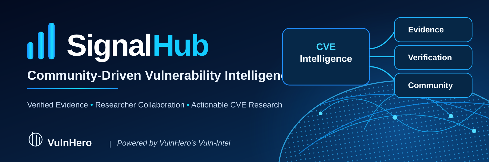
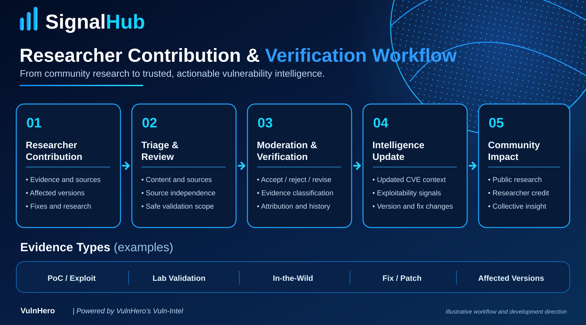

# SignalHub — Community Vulnerability Intelligence

**Open research collaboration. Traceable evidence. Better vulnerability decisions.**

[Explore SignalHub](https://signalhub.vulnhero.com) · [Community](https://signalhub.vulnhero.com/community) · [Developer Program](https://signalhub.vulnhero.com/developers) · [Vuln-Intel](https://vulnintel.vulnhero.com) · [VulnHero](https://vulnhero.com)

SignalHub is a community-powered vulnerability and exploitability intelligence initiative operated by **VulnHero**. It helps researchers explore CVE intelligence, share technical evidence, correct affected-version information, and contribute to more reliable vulnerability research.

> **Important scope:** SignalHub is a **proprietary web platform**. This public repository is for community guidance, evidence formats, research methods, and **selected, rights-cleared public intelligence data**. It does **not** publish SignalHub's frontend, backend, scoring algorithms, intelligence pipelines, internal APIs, or validation engine.

## Why this repository exists

Vulnerability intelligence changes over time. A disclosed CVE, a public proof of concept, an independently corroborated exploitation report, and a controlled laboratory validation are **different claims**. A PoC alone does not establish exploitation in the wild.

We want the community to make those distinctions visible by improving:

- **Evidence quality:** traceable references, clear claims, corrections, and independent corroboration.
- **Technical context:** affected products and versions, remediation information, and changes in exploitability signals.
- **Researcher participation:** moderated contributions, attribution, and quality-oriented reputation.
- **Responsible openness:** documentation, public research outputs, and datasets only where publication and redistribution rights allow.

## How to contribute

Researchers can use the [SignalHub community platform](https://signalhub.vulnhero.com/community) to contribute:

- Public PoC *references* and technical write-ups (not weaponized payload uploads)
- Exploitation claims with supporting sources
- Affected-product/version corrections
- Vendor advisories and remediation references
- Original analysis and responsible corrections

Contributions are reviewed before they are treated as accepted community intelligence. Acceptance does not imply that exploitation has been independently reproduced.

For contribution instructions, see [CONTRIBUTING.md](CONTRIBUTING.md).

## Researcher contribution & evidence verification



*Illustrative workflow and development direction. Not all depicted checks are implemented or automated in the current platform.*

## How evidence is interpreted

A record should distinguish **what was claimed**, **who or what supports it**, **when it was observed**, and **what review actually established**.

| Term | Meaning |
| --- | --- |
| Reported | A claim submitted for review; not endorsed |
| Source checked | The cited source can be located and supports the stated claim |
| Corroborated | Material support from an independently originated source |
| Lab validated | Tested in an authorized controlled environment for a stated scenario |
| In-the-wild evidence | Source-supported real-world exploitation claim; not inferred from a PoC |

These are **different evidence dimensions**, not a universal five-step trust ladder. Reviews may be revised, withdrawn, or disputed as new information emerges.

Read [Evidence Verification](docs/evidence-verification.md) for the public methodology and its limits.

## What is public here?

This repository starts with **documentation and a sample evidence format**. Live CVE datasets are **not** automatically mirrored from the commercial platform.

Future releases may include **selected** reviewed records, non-sensitive provenance metadata, aggregated research results, or research fixtures. Each dataset must undergo rights, source, privacy, and disclosure review and have an explicit license or reuse notice.

See [Data & Licensing Policy](docs/data-policy.md) and [Attribution Policy](docs/attribution-policy.md).

## Community recognition

SignalHub's community model emphasizes accuracy and accepted research over raw submission volume. Public site materials describe moderated contributions, attribution, reputation, and badges. Additional privileges, research opportunities, and reviewer roles are **ideas for future development**, not current entitlements.

See [Researcher Recognition](docs/researcher-recognition.md).

## Repository structure

```text
README.md                         Overview and links
CONTRIBUTING.md                   How to participate
CODE_OF_CONDUCT.md                Community expectations
SECURITY.md                       Private security reporting
docs/evidence-verification.md     How evidence claims should be distinguished
docs/data-policy.md               Publication, rights and licensing
docs/attribution-policy.md        Contributor credit principles
docs/researcher-recognition.md    Current model and roadmap boundaries
schemas/evidence.schema.json      Public proposed interchange schema
data/examples/sample-evidence.json Synthetic illustration, not live CVE intelligence
```

## Safety and disclosure

Do not post private credentials, personal information, unpublished embargoed vulnerabilities, unauthorized exploitation artifacts, or sensitive third-party data here. Report vulnerabilities **in SignalHub itself** privately; see [SECURITY.md](SECURITY.md).

GitHub Issues may be used for **documentation or public-data corrections**, but should **not** be used to send confidential security reports or private submissions.

## Open data is not open-source software

The open-collaboration and selected open-data approach **does not** mean the SignalHub application is open source. This repository does not assert eligibility for, or acceptance into, **Black Hat Arsenal**, which may impose separate open-source-tool requirements.

## Contact

**VulnHero** · [SignalHub](https://signalhub.vulnhero.com) · info@vulnhero.com

Copyright © 2026 VulnHero. Documentation and example data have no blanket reuse license unless a specific file or dataset says otherwise.
